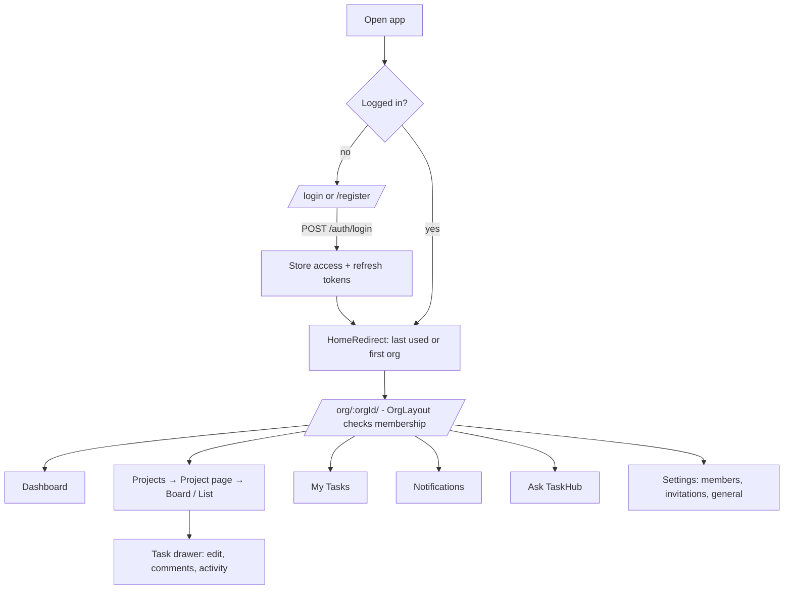

# TaskHub Frontend: Project Overview

The React single-page app for **TaskHub**, a multi-tenant project and task management platform. Users belong to one or more **organizations**. Inside an organization they manage projects and tasks on a Kanban board, get notifications, and ask an AI assistant about their work.

The Django REST API lives in the separate `taskhub-backend` repo. In development, Vite forwards every `/api` call to it at `http://localhost:8000`.

---

## Tech stack

| Area | Technology | Used for |
|---|---|---|
| UI library | React 19 (JSX) | Components and hooks |
| Build tool | Vite 8 | Dev server with hot reload, `/api` proxy, production build |
| Routing | React Router 7 | Nested and protected routes (`/org/:orgId/...`) |
| Client state | Redux Toolkit + react-redux | Auth session, current organization, UI state (sidebar) |
| Server state | TanStack React Query 5 | Fetching, caching, mutations, optimistic updates |
| HTTP | Axios | API client with JWT and automatic token refresh |
| Drag and drop | @dnd-kit (core, sortable) | Kanban board |
| Markdown | react-markdown | Rendering AI assistant answers |
| Styling | Plain CSS with design tokens (`src/index.css`) | Indigo–violet theme, animations, responsive layout |
| Font | Inter Variable (@fontsource) | Self-hosted typography |
| Linting | oxlint | Fast JS/JSX linter |
| Dev tools | React Query Devtools | Inspecting the query cache (dev only) |

---

## Folder structure

```
src/
  main.jsx            app entry: Redux Provider, QueryClientProvider, RouterProvider
  index.css           design system (colors, shadows, animations) + all component styles
  app/
    store.js          Redux store (auth, org, ui slices)
    listeners.js      reacts to org switch / logout (sets X-Org-ID, clears cache)
    queryClient.js    React Query defaults
    router.jsx        all routes
  api/
    client.js         Axios instance: Bearer token, X-Org-ID header, refresh on 401
    errors.js         turns DRF errors into field/form messages
  features/           one folder per feature: api.js + queries.js + components
    auth/  orgs/  projects/  tasks/  notifications/  dashboard/  assistant/  ui/
  components/         shared UI: Avatar, Icon, Modal, StatTile, Pagination, ...
  layouts/            AppLayout (header + sidebar), Sidebar, OrgLayout
  pages/              route-level pages (thin; they compose feature components)
  hooks/  utils/      useDebouncedValue, useDismiss, time helpers
```

Each feature folder follows the same pattern:

- **`api.js`:** plain request functions.
- **`queries.js`:** React Query hooks and **query-key factories**, for example `taskKeys.board(orgId, projectId)`.
- **Components:** used only by that feature.

---

## State: who owns what

| Kind of state | Where it lives | Examples |
|---|---|---|
| Client state | **Redux Toolkit** | logged-in flag, current org ID, mobile sidebar open |
| Server data | **React Query** | projects, tasks, comments, notifications, dashboard stats, chats |
| URL state | **React Router** | current org (`/org/:orgId`), open task (`?task=12`), filters |

Server data is never copied into Redux. After a change (mutation), the related React Query keys are refreshed (invalidated).

---

## Basic working flow



### 1. Authentication
- **Login and register:** these pages dispatch Redux thunks that call `/api/auth/login/` or `/api/auth/register/` and store the tokens.
- **Every request:** `api/client.js` attaches `Authorization: Bearer <access>`.
- **Expired token:** on a **401**, the client refreshes the token once, replays the original request, and sends you back to `/login` if the refresh fails.
- **Protected pages:** `ProtectedRoute` guards every app route and remembers where you were going, so invite links still work after you log in.

### 2. Organizations (multi-tenancy)
- **Current organization:** comes from the URL (`/org/:orgId`). `OrgLayout` confirms you're a member, then sets it in Redux.
- **Switching:** a Redux **listener** does three things:
  - sets the `X-Org-ID` header for every later API call
  - remembers the organization as "last used"
  - **clears the React Query cache**, so another organization's data never appears on screen
- **Cache keys:** every query key starts with `orgId`.

### 3. Projects, board and tasks
1. **Projects page:** search with a debounced box, switch between Active and Archived, and create or edit projects in a modal.
2. **Board page:** a Kanban board with To do, In progress, Review and Done columns, using @dnd-kit.
   - **Dragging a card** calls `PATCH /api/tasks/{id}/move/`.
   - **Optimistic update:** the board moves the card immediately (`onMutate`), puts it back if the server rejects the move (`onError`), then refreshes (`onSettled`).
   - **Quick add:** type a title at the bottom of any column to create a task there.
3. **List view:** the same tasks as a table, with search and filters for status, priority, assignee, overdue and sort order. Filters live in the URL.
4. **Task drawer:** opened with `?task=<id>`. It edits title, status, priority, assignee, due date, labels and description, and has **Comments** and **Activity** tabs.
5. **Role-based UI:** buttons the user's role can't use are hidden or disabled, for example viewers can't edit. The backend enforces the same rules.

### 4. Dashboard, My Tasks, notifications
- **Dashboard:** stat tiles (my work and organization totals), overdue tasks, status and priority bar charts, and a recent activity feed. All of it comes from one call to `/api/dashboard/`.
- **My Tasks:** everything assigned to you across projects, with filters.
- **Notifications:** the header bell shows the unread count and a dropdown, and the Notifications page has All/Unread and This organization/All organizations filters plus Mark all as read.

### 5. Ask TaskHub (AI assistant)
- **Layout:** chat list on the left, conversation on the right, with suggested questions in an empty chat.
- **Answers:** rendered as Markdown, with **citation chips** `[1]` that link to the source project, task or comment, plus a "Sources" list.
- **Project shortcut:** "Ask about this project" on a project page starts a chat limited to that project.

### 6. Settings
- **Members:** change roles or remove people, with an explanation of what each role can do.
- **Invitations:** invite by email with a role, then resend or revoke. Invitees accept at `/invitations/accept?token=...`.
- **General:** rename the organization, or delete it (owner only, in the danger zone).

---

## Routes

| Route | Page |
|---|---|
| `/login`, `/register` | Auth (public) |
| `/invitations/accept`, `/invite/:token` | Accept an invitation |
| `/` | Redirect to last used or first org |
| `/orgs/new` | Create organization |
| `/org/:orgId` | Dashboard |
| `/org/:orgId/projects` | Projects list |
| `/org/:orgId/projects/:projectId` | Project details + members |
| `/org/:orgId/projects/:projectId/board` | Kanban board / list view (`?task=` opens the drawer) |
| `/org/:orgId/my-tasks` | My Tasks |
| `/org/:orgId/notifications` | Notifications |
| `/org/:orgId/assistant/:conversationId?` | Ask TaskHub |
| `/org/:orgId/settings` | Members, invitations, general |

---

## Design system

- **Tokens:** all colors, radii, shadows and easing are CSS variables in `:root` at the top of `src/index.css`. The theme is light indigo–violet, with gradient accents (`--gradient`).
- **Animations:** pages fade up when they open, stat tiles appear one after another, bar charts grow in, the task drawer slides in, cards lift on hover, the bell's unread count pulses and the login background moves. They all switch off when the user prefers reduced motion.
- **Icons:** inline SVG icons from `components/Icon.jsx`, so no icon library is needed.
- **Mobile:** on screens narrower than 768px, the sidebar becomes a slide-out menu.

---

## Running locally

```powershell
npm install
copy .env.example .env     # VITE_API_URL=/api (uses the Vite proxy)
npm run dev                # http://localhost:5173  (start the backend on :8000 first)
```

| Script | What it does |
|---|---|
| `npm run dev` | Dev server with hot reload |
| `npm run build` | Production build into `dist/` |
| `npm run preview` | Serve the production build locally |
| `npm run lint` | Lint with oxlint |

**Demo login** (after running `python manage.py seed_demo` in the backend): `priya@pixelforge.dev`, password `DemoPass!2026`.
